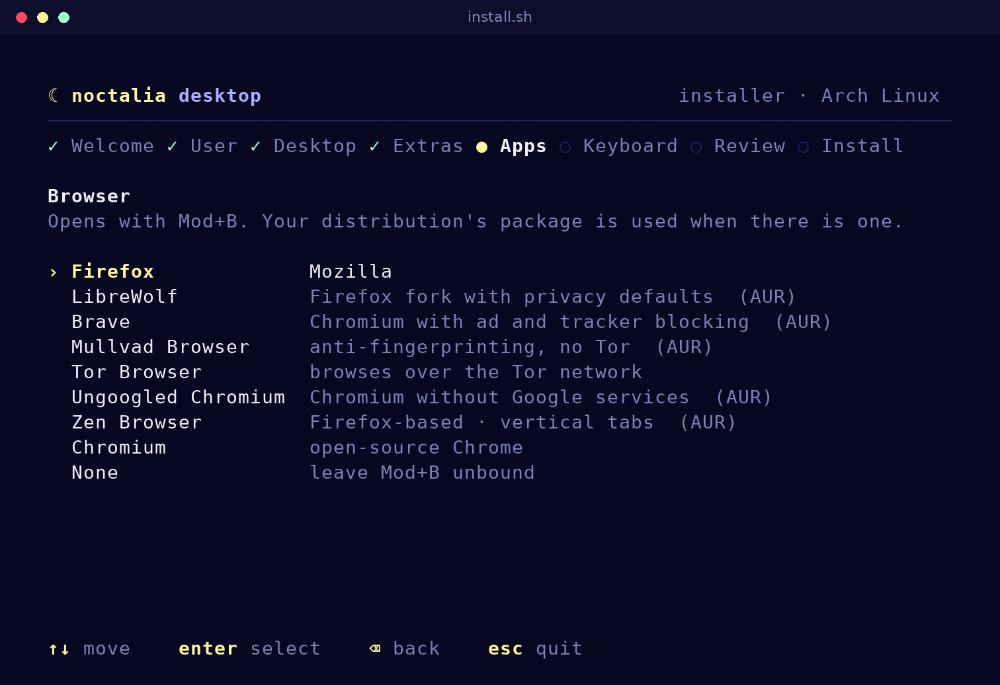
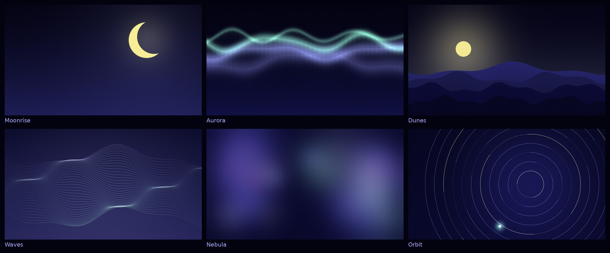
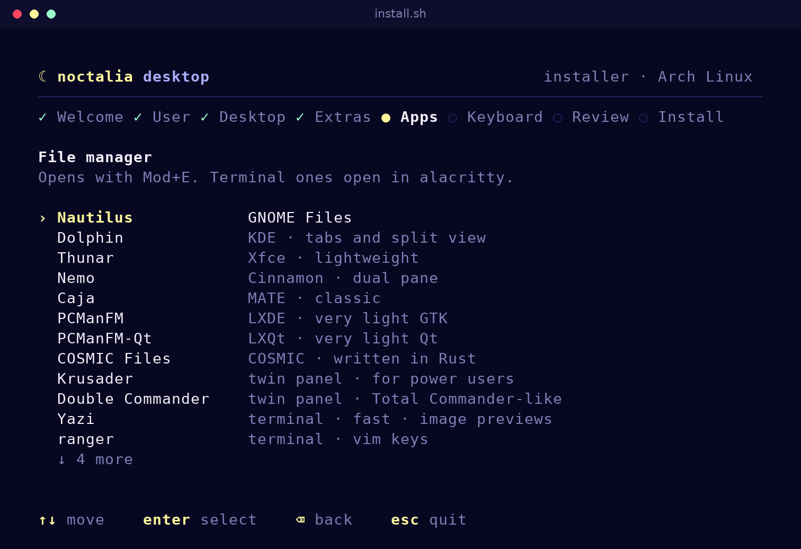

# noctalia-niri-config-setup

Ready-made configs and an installer for the [Noctalia v5](https://docs.noctalia.dev/noctalia/) shell, on every compositor Noctalia supports (**niri, Hyprland, Sway, Scroll, Mango, Labwc, Umbriel and KDE Plasma**) and every distribution Noctalia packages for (**Arch, Fedora, openSUSE, Debian/Ubuntu, Void, Alpine Edge, Chimera, Gentoo and Solus**). The installer uses Noctalia's own colors, and on Arch it can install the **yay** or **paru** AUR helper.


## Quick install

Works on a **fresh minimal install**, straight from the TTY and even as root:

```bash
curl -fsSL https://raw.githubusercontent.com/Abijspy/noctalia-niri-config-setup/main/install.sh | bash
```

Or from a clone:

```bash
git clone https://github.com/Abijspy/noctalia-niri-config-setup.git
cd noctalia-niri-config-setup
./install.sh
```

## The installer

The installer is a full-screen terminal UI written in plain bash, so it needs nothing extra on a minimal install. It uses the colors of Noctalia's built-in palette: navy surface, yellow primary, lavender secondary and mint accents. On a bare Linux console it temporarily switches the console to the Noctalia palette and uses symbols the console font can draw. The original palette comes back when the installer exits.

| | |
|---|---|
|  |  |
| **Desktop:** pick one or more compositors | **AUR helper:** paru, yay, an installed one, or none |
|  |  |
| **Extras:** greeter, type-to-launch, polkit agent, apps | **Apps:** terminal, file manager and browser, including privacy browsers |
|  |  |
| **Review:** nothing changes until you choose *Install now* | **Install:** live steps, progress bar and the latest log lines |


On a minimal install, straight from the TTY:


On other distributions, compositors your distribution doesn't package are greyed out, with the reason:


<sub>Screenshots are rendered from a test run, so the install log shows placeholder package names.</sub>

**Controls**

| Key | Action |
|---|---|
| `↑` / `↓` | Move between options (`Home` / `End` jump to the first / last) |
| `Enter` | Continue (picks the highlighted option) |
| `Space` | Tick or untick an item on the Desktop and Extras screens |
| `Backspace` or `←` | Go back to the previous page. In a text field, Backspace deletes first and goes back once the field is empty |
| `Esc` | Quit the installer. Nothing changes before you choose *Install now* |

**Screens**

1. **Welcome:** shows whether it found a laptop and an existing login manager.
2. **User:** only when run as root. Pick an existing user or create a new one. A new user is added to `wheel`, and `sudo` is installed and enabled for that group.
3. **Desktop:** choose one or more compositors. Press Enter to take the highlighted one, or tick several with Space first. Each one gets its own config, and with Noctalia Greeter you pick between them at login.
4. **Extras:** Noctalia Greeter, the [bar preset](#noctalia-bar-preset), [wallpapers](#wallpapers) (then pick the default one), overview type-to-launch, Noctalia's polkit agent, file manager and browser, and the lid-close lock (laptops only, and only with niri, Sway or Scroll). Then the **AUR helper**:
   - keep yay or paru if one is already installed, install **paru** or **yay**, or skip it;
   - Scroll and Umbriel are only in the AUR, so they need a helper.
5. **Apps:**
   - terminal: alacritty, kitty, foot, ghostty or wezterm;
   - file manager: 10 graphical and 5 terminal file managers, or none (see [File managers](#file-managers));
   - browser: Firefox, LibreWolf, Brave, Mullvad Browser, Tor Browser, Ungoogled Chromium, Zen Browser, Chromium or none (see [Browsers](#browsers)).

   The keybinds in every config are updated to match.
6. **Keyboard:** the layout is written into each compositor's config, e.g. `us` or `us,de`.
7. **Review:** if gdm, sddm or lightdm is active, it first asks whether to replace it with greetd. Then you can install, go back and change your choices, or quit.
8. **Install:** each step is shown as it runs, with a progress bar and the latest log lines. Keys are ignored during this step so it can't be stopped halfway.
9. **Done:** the main keybinds, any notes, and an offer to reboot.

If something fails, the installer shows the last lines of the log. The full log is at `/tmp/noctalia-niri-install.log`.

## Distributions

The installer reads `/etc/os-release`, adds Noctalia's repository the way [Noctalia's install guide](https://docs.noctalia.dev/noctalia/getting-started/installation/) describes, and installs everything with your distribution's package manager.

| Distribution | Package manager | Noctalia comes from | Noctalia Greeter |
|---|---|---|---|
| Arch Linux and derivatives (CachyOS, EndeavourOS, Manjaro…) | `pacman` (+ yay/paru for the AUR) | `[extra]` | yes |
| Fedora 44+ | `dnf` | Fedora; Terra for the greeter and Umbriel | yes |
| openSUSE Tumbleweed, Slowroll, Leap 16 | `zypper` | openSUSE; OBS `home:neifua:Noctalia` for Umbriel | Tumbleweed / Slowroll |
| Debian 13, Debian sid, Ubuntu 26.04 / 26.10 and derivatives | `apt` | Noctalia's APT repository (amd64 / arm64) | yes |
| Void Linux | `xbps` | UniversalRepository | — |
| Alpine Edge | `apk` | UniversalRepository | — |
| Chimera Linux | `apk` | Chimera's user repository | — |
| Gentoo | `emerge` | GURU overlay | — |
| Solus | `eopkg` | Solus | — |
| NixOS, Guix, anything else | — | **configs only** | — |

- **Package checks:** before installing, each package is looked up with your package manager.
  - A compositor your distribution doesn't package can't be picked.
  - A missing optional package (a font, a portal) is skipped and listed at the end.
  - If Noctalia or a chosen compositor can't be found, the installer stops before installing anything.
- **Configs only:** on NixOS, Guix, other distributions, and releases Noctalia doesn't package for (e.g. Debian 12, Fedora 43, Alpine stable), the installer writes the compositor and Noctalia configs and tells you what to install yourself.
- **Only on Arch:** the AUR (Scroll, `umbriel-git`, yay/paru) and the `pacman -Syu` system upgrade.
- **Greeter and lid lock:** these need systemd. The greeter is offered only where it's packaged.
- **Run as root on doas-only systems:** when there's no sudo (common on Alpine and Chimera), run the installer as root, e.g. `doas ./install.sh`.

## Compositors

| Compositor | Package (Arch) | Config written | Start from a TTY |
|---|---|---|---|
| niri | `niri` | `~/.config/niri/config.kdl` | `niri-session` |
| Hyprland | `hyprland` | `~/.config/hypr/hyprland.lua` | `start-hyprland` |
| Sway | `sway` | `~/.config/sway/config` | `sway` |
| Scroll | `sway-scroll` (AUR) | `~/.config/scroll/config` | `scroll` |
| Mango | `mangowm` | `~/.config/mango/config.conf` | `mango` |
| Labwc | `labwc` | `~/.config/labwc/rc.xml`, `autostart`, `environment` | `labwc` |
| Umbriel | `umbriel-git` (AUR) | `~/.config/umbriel/config.toml` | `umbriel` |
| KDE Plasma | `plasma-desktop` | `~/.config/autostart/noctalia.desktop` | `startplasma-wayland` |

Every config starts Noctalia, includes the Noctalia settings from its [compositor page](https://docs.noctalia.dev/noctalia/compositor-settings/niri/), and shares the same main keys where the compositor allows it:

| Keys | Action |
|---|---|
| `Mod+Space` | Noctalia launcher |
| `Mod+S` | Control center |
| `Mod+,` (`Mod+Shift+,` on niri) | Noctalia settings |
| `Mod+Return` / `Mod+E` / `Mod+B` | Terminal / file manager / browser |
| `Mod+Q` | Close window |
| `Mod+1`…`9`, `Mod+Shift+1`…`9` | Go to / move to workspace |
| Volume and brightness keys | Noctalia's volume and brightness controls |

What to know about each one:

- **niri:** blur everywhere, including the focused window (`draw-border-with-background false`, so the focus ring doesn't paint over the blur), and a blurred overview wallpaper. Noctalia settings opens as a maximized column (not fullscreen, so its blur stays). Needs niri 26.04 or newer for `background-effect` / `blur`.
- **Hyprland:** uses Hyprland's Lua config (`hyprland.lua`), the format Noctalia documents. An existing `hyprland.conf` is moved aside to a dated backup.
- **Sway / Scroll:** the same config, with Scroll reading its own `config.d` folder. Sway and Scroll can't blur Noctalia's surfaces.
- **Mango:** window blur on, layer blur off, as Noctalia recommends. Noctalia's docs also suggest turning off Noctalia's own shadows under Mango (`shadow = false` for `[bar.default]`, `[dock]` and `[shell.panel]`); the installer doesn't, because that setting would affect every compositor.
- **Labwc:** keeps Labwc's default keybinds and adds the Noctalia, app and close keys. Noctalia's line is appended to an existing `autostart` instead of replacing it.
- **Umbriel:** contains only the settings and keys documented on Noctalia's Umbriel page plus the app keys; window management uses Umbriel's own defaults. The keyboard layout isn't set, because that setting isn't documented.
- **KDE Plasma:** Noctalia is started through Plasma's autostart. Plasma has no blur for Noctalia, and no screenshots, clipboard history or night light from Noctalia. Set shortcuts (`noctalia msg …`) in System Settings.

## Noctalia bar preset

Instead of Noctalia's stock bar, the installer writes [`configs/noctalia/20-bar.toml`](configs/noctalia/20-bar.toml) to `~/.config/noctalia/` (untick it under Extras, or use `--stock-bar`, to keep the stock bar):

- **Floating:** `margin_edge = 8` and `margin_ends = 12` lift it off the screen edge, with `radius = 16` corners.
- **Blurred:** `background_opacity = 0.7` makes it see-through, and `compositor_blur = true` blurs what's behind it on compositors that support it (niri, Hyprland, Mango, Umbriel).
- **Capsules:** `capsule = true` puts a rounded capsule behind each widget.
- **Widgets:**

  | Start | Center | End |
  |---|---|---|
  | launcher, workspaces, active window | clock (`Thu 12 Nov  16:41`, full date on hover) | media, tray, privacy, notifications, network, bluetooth, volume, brightness, battery (with %), control center, session |

The installer checks the result with `noctalia config validate`. Change anything you like in the file. Settings you change in Noctalia's Settings window are saved to `~/.local/state/noctalia/settings.toml`, which loads after this file and wins for the same setting.

## Wallpapers

Six original 4K wallpapers in Noctalia's palette replace Noctalia's default wallpaper:



- **Install:** the installer copies all of them to `~/Pictures/Wallpapers/` (the folder Noctalia's wallpaper picker browses) and writes `~/.config/noctalia/30-wallpaper.toml`, setting `[wallpaper] directory` and `[wallpaper.default] path` to the one you pick.
- **Choosing:** pick the starting wallpaper in the installer or with `--wallpaper=moonrise|aurora|dunes|waves|nebula|orbit`. `--wallpaper=none` (or unticking it under Extras) keeps Noctalia's own.
- **Changing later:** use Noctalia's wallpaper panel. A wallpaper picked there is saved to `~/.local/state/noctalia/settings.toml` and takes precedence over the config file.
- **Licence:** the wallpapers are generated for this project by [`tools/gen-wallpapers.py`](tools/gen-wallpapers.py), so you can regenerate or tweak them.

## File managers

Mod+E opens the file manager you pick. Terminal file managers open inside the terminal you chose (e.g. `kitty yazi`, `alacritty -e ranger`).

| Graphical | | Terminal | |
|---|---|---|---|
| Nautilus | GNOME Files | Yazi | fast, image previews |
| Dolphin | KDE, tabs and split view | ranger | vim keys |
| Thunar | Xfce, lightweight | lf | minimal |
| Nemo | Cinnamon, dual pane | nnn | tiny and fast |
| Caja | MATE, classic | Midnight Commander | twin panel |
| PCManFM / PCManFM-Qt | LXDE / LXQt, very light | | |
| COSMIC Files | COSMIC, written in Rust | | |
| Krusader | twin panel for power users | | |
| Double Commander | Total Commander-like | | |

Each one is looked up in your distribution's repositories, including the distro-specific name (e.g. `Thunar` on Fedora; `doublecmd-qt6` / `doublecmd-qt` / `doublecmd-gtk` for Double Commander). File managers that aren't packaged for your distribution are greyed out. The list scrolls on an 80×24 console.



## Browsers

Firefox and Chromium plus privacy-focused browsers. Each one comes from the first source available:

1. your distribution's repositories;
2. on Arch, the AUR, if you have yay/paru or chose to install one;
3. otherwise [Flathub](https://flathub.org) (installs `flatpak` and adds the Flathub remote).

The browser screen shows which source will be used, and Mod+B launches whatever was installed.

| Browser | Arch | Flathub |
|---|---|---|
| Firefox | `firefox` | `org.mozilla.firefox` |
| LibreWolf | `librewolf-bin` (AUR) | `io.gitlab.librewolf-community` |
| Brave | `brave-bin` (AUR) | `com.brave.Browser` |
| Mullvad Browser | `mullvad-browser-bin` (AUR) | `net.mullvad.MullvadBrowser` (community build) |
| Tor Browser | `torbrowser-launcher` | `org.torproject.torbrowser-launcher` |
| Ungoogled Chromium | `ungoogled-chromium-bin` (AUR) | `io.github.ungoogled_software.ungoogled_chromium` |
| Zen Browser | `zen-browser-bin` (AUR) | `app.zen_browser.zen` |
| Chromium | `chromium` | `org.chromium.Chromium` |

- **Other distributions:** the installer looks for a package named like the browser (e.g. `librewolf`, `brave-browser`, `torbrowser-launcher`) and falls back to Flathub when it isn't there.
- **Vendor preferences:** Brave recommends its native package over the Flatpak.
- **Mullvad's Flatpak** is a community wrapper, not made by Mullvad.

## What gets installed

- `noctalia` (v5), portals, PipeWire, `playerctl`, `brightnessctl`, fonts, and the packages for each compositor you pick, under your distribution's package names. On Arch this runs a full `pacman -Syu`.
- On Arch with an AUR helper, yay or paru is built from source from the AUR as your user, the standard way:
  ```bash
  sudo pacman -S --needed git base-devel
  git clone https://aur.archlinux.org/yay.git    # or paru.git
  cd yay && makepkg -si
  ```
  `makepkg -s` pulls in the build tools (Go for yay, Rust for paru). AUR packages (Scroll, Umbriel, AUR browsers) are then installed through the helper, also as your user.
  - Run as root, the installer gives that user passwordless `sudo` only while it builds, and removes the rule straight after (and on exit).
- A config for each compositor you picked (see the table above). Any existing file is backed up first.
- `~/.config/noctalia/10-installer.toml`, which turns on overview type-to-launch for niri and Umbriel and the polkit agent.
- If you choose the greeter: `noctalia-greeter` (which pulls in `greetd`) and `polkit`. The installer sets `command` in `[default_session]` of `/etc/greetd/config.toml`, keeps the greeter account your distribution's greetd already uses (or sets `greeter` if there is none), and leaves the rest of the file unchanged. On Debian and Ubuntu the greeter package configures greetd itself, so the file isn't touched:
  ```toml
  [default_session]
  command = "/usr/bin/noctalia-greeter-session"
  user = "greeter"
  ```
  It then runs `noctalia-greeter-apply-appearance --setup-system` and enables `greetd`. Your old login manager is disabled but not stopped, so your current session keeps running. The switch happens when you reboot.

## Options

| Flag | Effect |
|---|---|
| `--no-tui` | Plain text prompts instead of menus |
| `--yes` | No prompts at all, use defaults and flags |
| `--compositors=…` | Comma-separated: `niri` `hyprland` `sway` `scroll` `mango` `labwc` `umbriel` `kde` (default `niri`) |
| `--aur-helper=…` | Arch only: `auto` (keep an installed one, else paru when needed), `paru`, `yay`, `none` |
| `--user=NAME` | User to set up when run as root |
| `--terminal=…` | `alacritty` `kitty` `foot` `ghostty` `wezterm` |
| `--file-manager=…` | `nautilus` `dolphin` `thunar` `nemo` `caja` `pcmanfm` `pcmanfm-qt` `cosmic-files` `krusader` `doublecmd` `yazi` `ranger` `lf` `nnn` `mc` `none` |
| `--browser=…` | `firefox` `librewolf` `brave` `mullvad` `tor` `ungoogled` `zen` `chromium` `none` |
| `--layout=…` | Keyboard layout(s), e.g. `us,de` |
| `--no-apps` | Skip the file manager and browser (a terminal is always installed) |
| `--no-greeter` | Skip Noctalia Greeter and greetd |
| `--lid-fix` | Lock the screen before suspend when the lid closes (niri, Sway, Scroll) |
| `--stock-bar` | Keep Noctalia's default bar instead of the bar preset |
| `--wallpaper=…` | `moonrise` `aurora` `dunes` `waves` `nebula` `orbit`, or `none` for Noctalia's own |

Example of a fully unattended install as root:

```bash
./install.sh --yes --user=me --compositors=niri,hyprland,scroll --aur-helper=paru --terminal=kitty
```

> If the greeter doesn't appear after you reboot, switch to a TTY (`Ctrl+Alt+F2`) and run `systemctl status greetd`.

## Manual install

Copy the config for your compositor from `configs/`, for example niri:

```bash
mkdir -p ~/.config/niri
cp configs/niri/config.kdl ~/.config/niri/config.kdl
niri validate
```

The configs launch `alacritty`, `nautilus` and `firefox` and use the `us` keyboard layout; change those lines to suit you.
